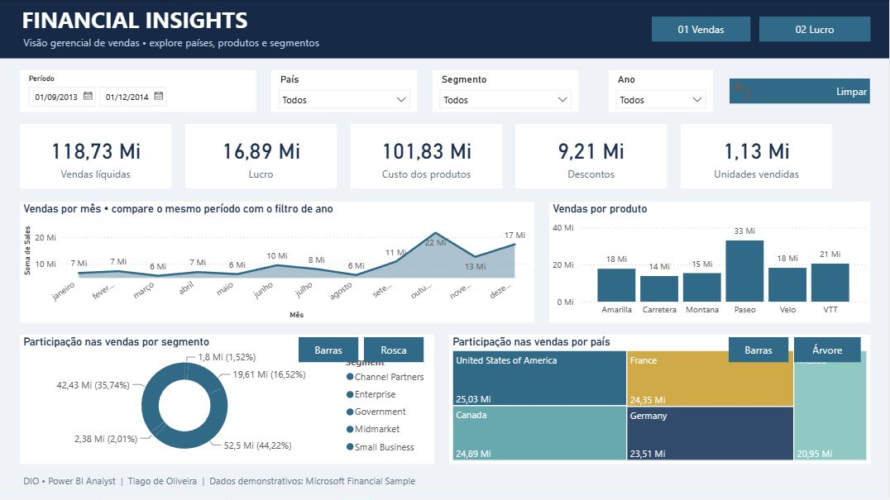
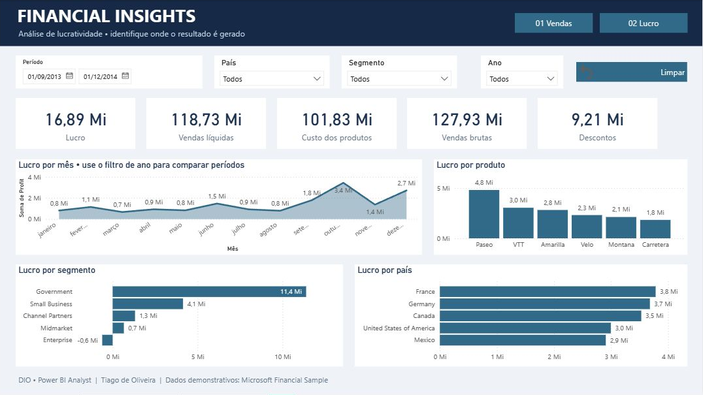

# Financial Insights · Power BI

Relatório gerencial de **vendas e lucratividade**, desenvolvido para o desafio **Criando um Relatório Gerencial de Vendas com Power BI**, da formação Power BI Analyst na DIO.

**Autor da adaptação:** Tiago de Oliveira · [GitHub](https://github.com/tiagodoliver)

**[Baixar o relatório (.pbix)](Financial-Insights.pbix)** · [Dados](dados/Financial%20Sample.xlsx) · [Documentação e validação](docs/PROJETO.md)

## Visão de vendas

Vendas líquidas, lucro, custo dos produtos, descontos e unidades vendidas. A análise combina evolução mensal, vendas por produto e participação por segmento e país. Botões permitem alternar entre barras e rosca ou entre barras e treemap.

## Lucratividade

Resultado por mês, produto, segmento e país, com cartões de lucro, vendas líquidas, custos, vendas brutas e descontos.

## Como explorar

1. Baixe e abra `Financial-Insights.pbix` no Power BI Desktop.
2. Use os filtros de **período, país, segmento e ano** em cada página.
3. Navegue pelos botões **01 Vendas** e **02 Lucro**.
4. Na primeira página, use **Barras / Rosca** e **Barras / Árvore** para trocar a representação do mesmo assunto.
5. Use **Limpar**, acompanhado do ícone de restauração, para remover os filtros da página.

No modo de edição do Desktop, os botões de ação exigem **Ctrl + clique**. Também podem ser acionados selecionando o botão e pressionando **Ctrl + Enter**. Os filtros das duas páginas são independentes. A consulta do relatório funciona com os dados já incorporados ao arquivo.

## Resultados da amostra

| Indicador | Total sem filtros |
|---|---:|
| Vendas líquidas | 118.726.350,26 |
| Lucro | 16.893.702,26 |
| Custo dos produtos | 101.832.648,00 |
| Descontos | 9.205.248,24 |
| Vendas brutas | 127.931.598,50 |
| Unidades vendidas | 1.125.806 |

São **700 registros**, referentes a setembro de 2013 a dezembro de 2014. Valores monetários apresentados na unidade da amostra, sem conversão cambial; o relatório não os identifica como reais. A margem agregada calculada a partir de lucro / vendas é aproximadamente **14,23%**.

Algumas leituras do conjunto completo:

- **Paseo** lidera vendas (33,01 milhões) e lucro (4,80 milhões).
- **Government** apresenta o maior lucro: 11,39 milhões.
- **Enterprise** soma prejuízo de aproximadamente 614,55 mil, apesar de 19,61 milhões em vendas.
- Os **Estados Unidos** lideram vendas; a **França** lidera lucro.

Essas observações descrevem a amostra e não demonstram causas. O ano de 2013 contém somente quatro meses; totais anuais brutos não representam períodos equivalentes. Nos gráficos mensais, o filtro de ano permite analisar um ano de cada vez; sem ele, meses de anos diferentes são agregados.

## Power BI Service — publicação pendente

O relatório foi concluído e validado no **Power BI Desktop**. **Não foi publicado no Power BI Service**: o ambiente disponível não possuía sessão autenticada no serviço e a página de acesso solicitou uma conta corporativa ou de estudante. O responsável informou que utiliza somente o Desktop. Portanto, não há link de relatório online nesta entrega.

Com uma conta habilitada, basta abrir o `.pbix`, entrar no Power BI, selecionar **Publicar**, escolher um workspace autorizado e verificar o relatório no Service. A disponibilidade de compartilhamento depende das permissões e da licença da conta. Esta etapa permanece pendente em relação ao enunciado original.

## Origem e créditos

Este repositório é um **fork** de [julianazanelatto/power_bi_analyst](https://github.com/julianazanelatto/power_bi_analyst). A base de dados e o modelo inicial vieram do material da professora, em [Módulo 2 / Desafio de Projeto](https://github.com/julianazanelatto/power_bi_analyst/tree/main/M%C3%B3dulo%202/Desafio%20de%20Projeto), no commit `b010c1874a183a0fb4b831e76dc68b9b872becec`.

O projeto adapta o relatório de referência com nova composição visual, tema próprio, duas páginas reorganizadas, visuais nativos, filtros adicionais, cartões corrigidos e documentação de uso e validação. O vínculo e o histórico do fork preservam a referência à professora. Os demais arquivos de aulas foram retirados da versão atual deste fork para manter apenas os arquivos usados na entrega; continuam disponíveis no repositório original e no histórico.

Dados demonstrativos **Financial Sample**, da Microsoft, disponibilizados no material da formação. Não representam dados financeiros pessoais ou de uma empresa real do autor.
